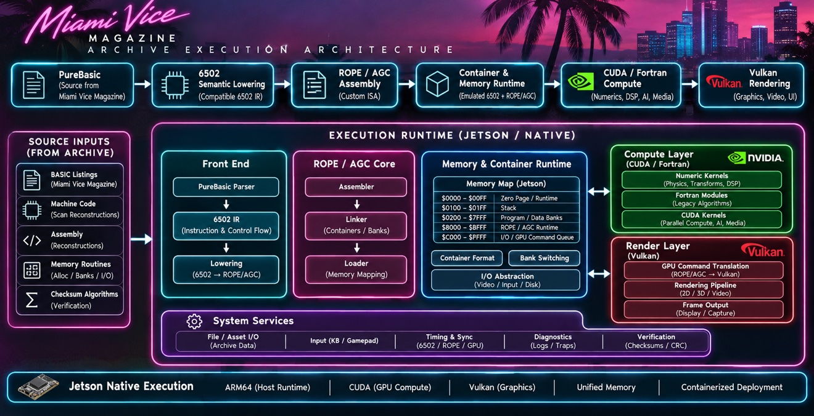

# Miami Vice Archive



**An execution architecture for archived Miami Vice Magazine BASIC listings.**

Source listings enter as data, are parsed and lowered through a 6502 intermediate representation into ROPE/AGC assembly, and execute in a container and memory runtime — banked memory, a declared memory map, an I/O and GPU command queue — with Pascal/Fortran compute and Vulkan rendering layers behind the runtime, targeting a Jetson as the native host.

The architecture is specified by the poster above. [BLUEPRINT.md](BLUEPRINT.md) decomposes it into components and records what already exists, what is partial, and what this build adds, stage by stage. [STATUS.md](STATUS.md) keeps the verified state separate from the staged work.

## Pipeline

```
PureBasic (Miami Vice Magazine listings)
    ↓
6502 Semantic Lowering (compatible 6502 IR)
    ↓
ROPE / AGC Assembly (custom ISA)
    ↓
Container & Memory Runtime (emulated 6502 + ROPE/AGC)
    ↓
Pascal / Fortran Compute (numerics, DSP, AI, media)
    ↓
Vulkan Rendering (graphics, video, UI)
```

## Key Documents

| Document | Purpose |
|----------|---------|
| [BLUEPRINT.md](BLUEPRINT.md) | Full component map, existing vs. staged, Stage 1–6 plan |
| [STATUS.md](STATUS.md) | Verified facts vs. staged work |
| [AGENTS.md](AGENTS.md) | Laws of this repository (verify before commit, provenance, claims match execution) |
| [LICENSE](LICENSE) | Sovereign license |

## Runtime

Stage 1 (memory & container runtime) is implemented and verified in `runtime/`:

- `mv6502.erl` — banked 6502 core implementing the poster's memory map (zero page, stack, banked $0200–$7FFF, runtime RAM, GPU command queue, vector shadow)
- `mv_asm.erl` — assembler
- Tests: 4/4 suites, 16 checks passing (CPU regressions + bank isolation, queue capture, etc.)

See [BLUEPRINT.md](BLUEPRINT.md) for the complete stage plan and [STATUS.md](STATUS.md) for current verified state.

## Related Repositories

- [6502-transformer](https://github.com/AHMADALIPARR/6502-transformer) — 6502 and AGC assembly corpora
- [ace-sovereign](https://github.com/AHMADALIPARR/ace-sovereign) — verified 6502 container machine this runtime descends from

---

*Built to the poster's map. Verified by execution.*
