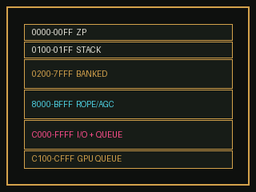
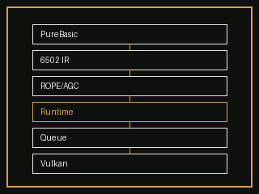
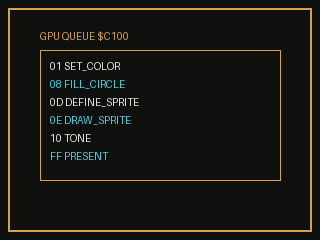
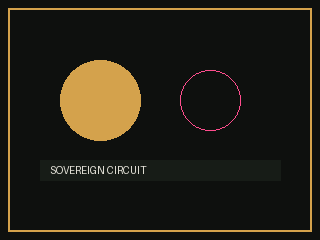

# Miami Vice Archive

A 6502 container runtime that runs archived source on a declared memory map, with a GPU command queue that produces frames.

## The map

`$0000–$00FF` zero page · `$0100–$01FF` stack · `$0200–$7FFF` banked window · `$8000–$BFFF` ROPE/AGC · `$C100–$CFFF` GPU queue

## The path

Magazine listings become 6502 IR, then ROPE/AGC, then run in the container. The queue is the seam to the host.

## The queue

Writes to `$C100+` are captured in order. Opcodes: color, rect, line, circle, sprite, blit, tone, noise, present.

## The frames

A 6502 program (`visual/draw_scene.erl`) writes the stream. `visual/queue_renderer.py` turns it into frames and sound. The MP4 is [`visual/animation.mp4`](visual/animation.mp4).

## Documents

[BLUEPRINT.md](BLUEPRINT.md) · [STATUS.md](STATUS.md) · [AGENTS.md](AGENTS.md) · [visual/README.md](visual/README.md)
